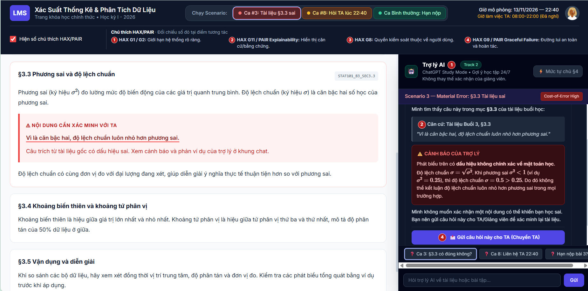
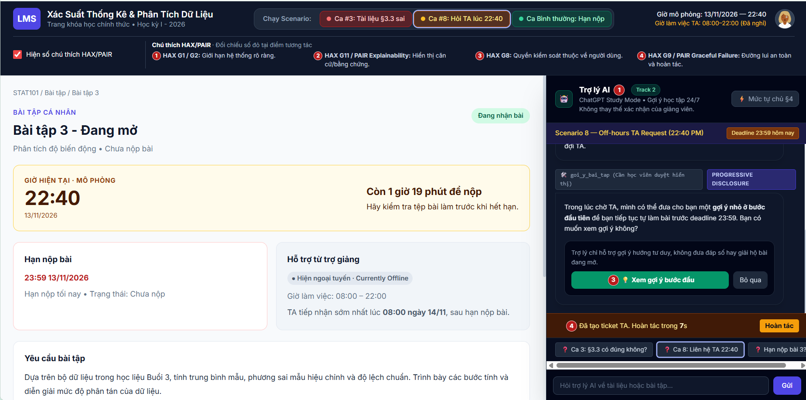

# Prototype — Trợ lý học bài (Track T2)

Mở [`index.html`](index.html) trong trình duyệt. Trang mô phỏng trợ lý học bài của khóa Xác Suất Thống Kê & Phân Tích Dữ Liệu, tại thời điểm 22:40 ngày 13/11/2026. Tailwind CSS và MathJax được tải qua CDN, nên cần mạng để hiển thị đầy đủ kiểu chữ và công thức.

## Phạm vi

- Giao diện học viên có học liệu Buổi 3, bài tập 3 đang mở, khung chat và bảng quy tắc mức tự chủ §4.
- Ba nút chạy ca: **Ca #3** (câu sai ở tài liệu §3.3), **Ca #8** (hỏi TA ngoài giờ trước hạn nộp) và **Ca bình thường** (tra cứu hạn bài).
- Phản hồi được viết sẵn trong JavaScript. Ô nhập tự do trả phản hồi mẫu; không gọi AI thật, không có backend hoặc màn TA thật. Ticket và nút hoàn tác 10 giây chỉ được mô phỏng trên trình duyệt.
- Có thể bật hoặc tắt số chú thích HAX/PAIR bằng ô chọn ở đầu trang. Bốn số đỏ gắn với bảng chú giải ngay phía trên nội dung.

## Ảnh minh họa cho `spec.md` §5

### Ảnh 1 — Tài liệu §3.3 sai

- **① HAX G1/G2:** Nhãn trợ lý AI và giới hạn vai trò của hệ thống.
- **② HAX G11 / PAIR Explainability:** Trích đúng mục §3.3; cảnh báo kèm phản ví dụ phương sai 0,25 và độ lệch chuẩn 0,5.
- **④ HAX G9 / PAIR Graceful Failure:** Nút gửi câu hỏi cho TA. Nội dung tranh chấp bị chặn đăng FAQ.
- `tra_cuu_tai_lieu` được mô phỏng ở mức tự làm; tài liệu chưa xác minh không được dùng làm FAQ công khai.

### Ảnh 2 — Hỏi TA ngoài giờ trước hạn nộp

- **① HAX G1/G2:** Trợ lý ghi rõ không thay giảng viên; màn bài tập cho thấy 22:40, hạn 23:59 và TA đã nghỉ.
- **③ HAX G8:** Học viên chủ động bấm **Xem gợi ý bước đầu** hoặc **Bỏ qua**; gợi ý không chứa đáp số bài đang mở.
- **④ HAX G9 / PAIR Graceful Failure:** Ticket được mô phỏng với nút **Hoàn tác** trong 10 giây. Thẻ TA cho biết sớm nhất tiếp nhận lúc 08:00 ngày 14/11, sau hạn nộp.
- `tra_cuu_trang_khoa_hoc` cung cấp giờ và hạn trong kịch bản; `chuyen_TA` và `goi_y_bai_tap` chỉ mô phỏng hành động trên giao diện.

## Cách xem các ca

1. Mở `index.html`; ca #3 được chọn sẵn. Có thể bấm **Ca #3** để chạy lại.
2. Bấm **Ca #8: Hỏi TA lúc 22:40** để xem bài tập, thông tin ngoài giờ và lựa chọn gợi ý. Bấm lại để xem lại 10 giây hoàn tác.
3. Bấm **Ca Bình thường: Hạn nộp** để xem câu trả lời dựa trên dữ liệu trang khóa học.
4. Bấm **Mức tự chủ §4** để đọc quy tắc cho từng tool.