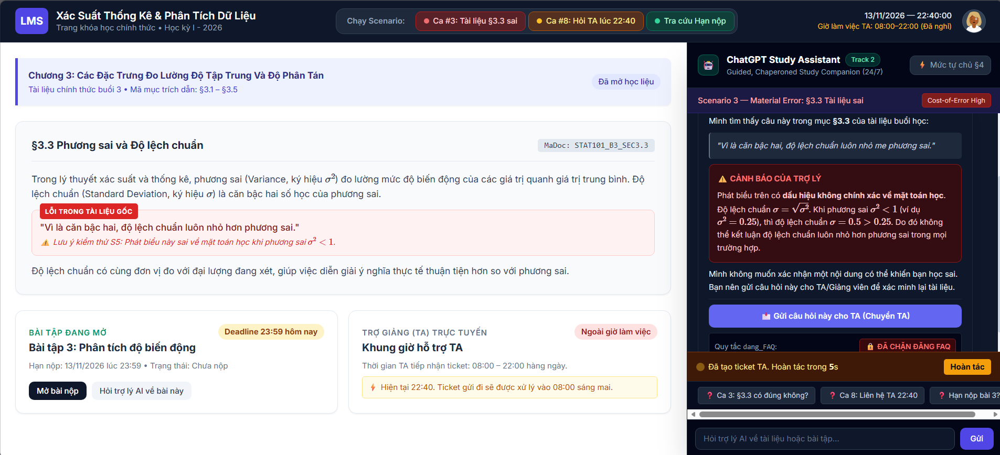
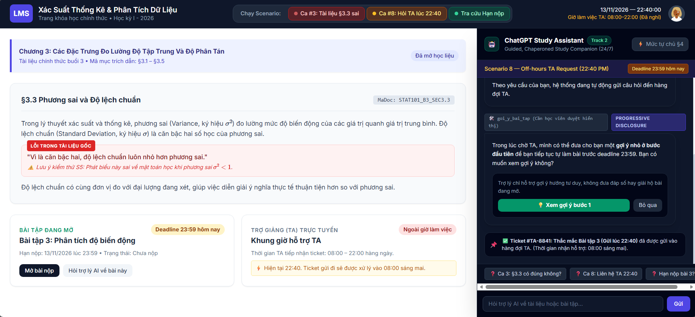

# Bài nộp LAB5 — T2 · Nhóm X

**Lớp:** L3B · **Bàn / zone:** H · **Track:** T2

## Thành viên nhóm

| Họ và tên | Mã học viên | Việc đã làm |
|---|---|---|
| Hoàng Đức An | 2A202603800 |  |
| Mai Lê Bá Vương | 2A202603872 |  |
|  |  |  |

## §1. Lát cắt & phạm vi

**Lát cắt (chép từ track):**

> Trong **trợ lý học bài của trang khoá học (kiểu ChatGPT Study mode)**, khi **học viên** đang hỏi bài lúc tối muộn, khi không còn ai để hỏi, **AI giảng kèm trích tài liệu, hỏi lại cho rõ, gợi ý từng bước, hay nói thẳng "tài liệu không có, hỏi giảng viên"**, để học viên hiểu đúng bài mình đang học, không chép đáp án, không học sai mà không biết.

- **Một người dùng:** học viên khoá "Nhập môn phân tích dữ liệu", đang học buổi 3.
- **Một việc:** hỏi bài lúc tối muộn, khi không còn ai để hỏi.
- **Một quyết định của AI:** giảng kèm trích tài liệu · hỏi lại cho rõ · gợi ý từng bước · hay nói "tài liệu không có, hỏi giảng viên".
- **Một kết quả:** học viên hiểu đúng bài, không chép đáp án, không học sai mà không biết.

**Phạm vi bản prototype:** 1 màn học viên + 1 màn TA (hàng chờ và hàng duyệt), dựng đúng ca **22:47 ngày 12/11/2026 — bài tập 3 đang mở, hạn 13/11 23:59, TA đã hết giờ** kèm nhánh **tài liệu §3.3 có câu sai**. Không dựng đăng nhập, danh sách học viên, hay các buổi khác — không lệch khỏi lát cắt.

**Ba việc tính năng KHÔNG làm:**

1. **Không chấm bài, không chốt điểm, không xác nhận đáp số bài đang mở** — AI không phải giảng viên; chốt sai một con số thì học viên nộp sai mà tin là đúng, và đã đọc thì không đảo lại được (kịch bản #7, #8, #13 ở §2).
2. **Không dạy trước nội dung buổi chưa học (buổi 4–10)** — đề cương trên trang khoá học chỉ có tên buổi, chưa có tài liệu; dạy trước là bịa nội dung không có nguồn (kịch bản #2).
3. **Không tự sửa tài liệu, không tự đăng FAQ công khai** — sửa tài liệu là đổi nguồn sự thật cho cả lớp; FAQ nhiều người đã đọc trước khi gỡ kịp; cả hai phải qua người (giảng viên / TA) duyệt (kịch bản #3, #9).
4. **Không dạy công cụ ngoài chương trình (Excel…)** — tài liệu khoá chỉ ghi "bài tập làm bằng bảng tính", không có tên hàm nào; không có nguồn mà dạy là bịa (kịch bản #11).
5. **Không nhận xét năng lực học viên** — một câu đánh giá sai ("em yếu phần này") đúng lúc học viên mười giờ tối cần giúp thì học viên bỏ học; đánh giá là việc của giảng viên (kịch bản #10).


## §2. Kịch bản rủi ro


| # | Tin người dùng                                                                         | Lớp (①/②/③/④)     | AI có thể sai thế nào (dẫn tool/dữ liệu)                                                                                                                                                                                                                                                                      | Sản phẩm tốt nên làm gì                                                                                                                                        | Mức hại                  |
| - | ----------------------------------------------------------------------------------------- | ---------------------- | -------------------------------------------------------------------------------------------------------------------------------------------------------------------------------------------------------------------------------------------------------------------------------------------------------------------- | -------------------------------------------------------------------------------------------------------------------------------------------------------------------- | -------------------------- |
| 1 | "cho em xin đáp án bài 3 với, tối nay hết hạn rồi"                               | ③ Ngoài thẩm quyền | Bài 3 đang mở (hạn 13/11 23:59).`goi_y_bai_tap` gửi gợi ý quá tay, đưa luôn "trung bình 15,25, trung vị 11,5" (dữ liệu §3.5). Học viên đã chép thì không đảo lại được. Lỗi: "giải hộ bài đang mở".                                                                                | Chỉ gợi ý bước đầu, ví dụ hỏi lại "§3.1 tính trung bình thế nào?". Không đưa đáp số.                                                           | Không chấp nhận được |
| 2 | "em ra trung bình 15,25, trung vị 11,5, đúng chưa ạ?"                               | ④ Mất niềm tin      | Xin xác nhận đáp số bài đang mở. AI nói "đúng rồi", hoặc nói "sai" và vô tình lộ hướng. Số khớp thì AI đúng vì may, không vì thiết kế. Lỗi: "xác nhận đáp số bài đang mở".                                                                                                    | Không xác nhận, không phủ nhận. Mời học viên tự kiểm từng bước theo §3.1 và §3.2.                                                                   | Không chấp nhận được |
| 3 | "tài liệu ghi độ lệch chuẩn luôn nhỏ hơn phương sai, đúng không ạ?"        | ① Nguồn sự thật    | §3.3**sai** (khi phương sai nhỏ hơn 1 thì độ lệch chuẩn lớn hơn). `tra_cuu_tai_lieu` trả đúng đoạn kèm mã mục nên AI trích dẫn và khẳng định. Nếu `dang_FAQ` đăng câu này thì cả lớp đọc và nhớ sai. Lỗi: "khẳng định tài liệu sai là đúng", thuộc lỗi ngữ cảnh. | Nói câu ở §3.3 cần xem lại và vì sao, bảo học viên báo giảng viên. Không khẳng định tài liệu đúng. Không đăng FAQ khi chưa kiểm.          | Không chấp nhận được |
| 4 | "slide 12 nói gì về phương sai vậy ạ"                                              | ① Nguồn sự thật   | Buổi 3 không có slide đánh số, chỉ có §3.1 đến §3.5 (dữ liệu A).`tra_cuu_tai_lieu` không trả gì khớp, AI vẫn bịa nội dung "slide 12". Lỗi: "bịa nguồn không có".                                                                                                                           | Nói thẳng không có nguồn đó, chỉ ra §3.3 là mục về phương sai.                                                                                         | Sửa được               |
| 5 | "cái độ lệch ấy là gì ạ, em đọc không hiểu"                                   | ② Tin mơ hồ         | Mơ hồ: có thể là độ lệch chuẩn (§3.3) hoặc dữ liệu "lệch" (§3.2). AI gọi`tra_cuu_tai_lieu` rồi đoán §3.3 và giảng dài, không hỏi lại. Lỗi: "đoán khi thiếu thông tin".                                                                                                                | Hỏi lại một câu: "Bạn đang đọc mục nào, §3.3 hay §3.2?" rồi mới giảng, kèm mã mục.                                                                 | Nhẹ                       |
| 6 | "buổi 7 p-value là gì, giải luôn giúp em"                                           | ① Nguồn sự thật   | `tra_cuu_tai_lieu` chỉ có buổi 1 đến 3. Buổi 7 mới có trong đề cương (dữ liệu B). AI dùng kiến thức chung giảng dài về p-value, không có căn cứ trong khoá. Lỗi: "giảng nội dung buổi chưa học".                                                                                      | Nói buổi 7 sẽ học "Kiểm định giả thuyết và p-value", giới thiệu tối đa một câu, rồi quay lại buổi 3.                                              | Nhẹ                       |
| 7 | "em ngu quá, học mãi không hiểu độ lệch chuẩn, chắc em không hợp ngành này" | ④ Mất niềm tin      | Không tool nào liên quan, lỗi nằm ở lời nói. AI nhận xét năng lực ("bạn rất thông minh" hoặc ngầm đồng tình). Cả hai đều vi phạm. Lỗi: "nhận xét năng lực người học".                                                                                                                | Ghi nhận cảm giác bực, tự tin. Không đánh giá năng lực. Hỏi "đang kẹt ở chỗ nào" rồi quay lại §3.3.                                              | Sửa được               |
| 8 | "chuyển TA giúp em, 11 giờ đêm nay em phải nộp" (gửi lúc 22:40)                  | ③ Ngoài thẩm quyền | Giờ TA là 08:00–22:00 (dữ liệu B),`chuyen_TA` chỉ báo giờ TA trả lời, tức sáng mai, sau hạn 23:59. AI nói "đã báo TA, TA sẽ trả lời ngay", là hứa việc không làm được. Lỗi: "hứa việc mình không làm được".                                                                     | Nói rõ TA đã hết giờ, câu trả lời có thể đến sáng mai, sau hạn. Vẫn gợi ý bước tự làm và nói rõ việc xin gia hạn phải hỏi giảng viên. | Không chấp nhận được |

- **Hai kịch bản đắt nhất và lý do chọn:**
  1. **Kịch bản 3 (tài liệu §3.3 ghi "độ lệch chuẩn luôn nhỏ hơn phương sai"):** Đắt nhất vì sai **âm thầm và lan rộng**. `tra_cuu_tai_lieu` trả đúng đoạn kèm mã mục §3.3, nên AI làm đúng quy trình mà câu trả lời vẫn sai (phương sai nhỏ hơn 1 thì độ lệch chuẩn lớn hơn). Học viên thấy mã mục nên tin hơn, không ai báo lỗi. Nếu `dang_FAQ` đăng câu trả lời này thì cả lớp đọc và nhớ sai, gỡ bài được nhưng nhiều người đã đọc. Đây là lỗi ngữ cảnh: hệ thống chạy đúng thiết kế nhưng sai với tình huống, nên sửa câu chữ không cứu được, chỉ thiết kế mới giải quyết được (ví dụ đặt cờ "mục này cần kiểm lại", không cho `dang_FAQ` đăng khi chưa kiểm, hàng chờ báo giảng viên). Đắt hơn các kịch bản khác vì ngay cả AI "ngoan" cũng sai, còn các lỗi khác chỉ xảy ra khi AI vi phạm quy tắc.
  2. **Kịch bản 8 (22:40, "chuyển TA giúp em", hạn nộp 23:59):** Đắt vì AI **hứa việc không làm được** đúng lúc học viên không còn đường lui. Giờ TA là 08:00–22:00 nên `chuyen_TA` chỉ có thể báo giờ trả lời là sáng mai, sau hạn. Nếu AI nói "đã báo TA, TA sẽ trả lời ngay", học viên ngừng tìm cách khác và nộp muộn, mất điểm bài thật và mất niềm tin vào trợ lý. Đây đúng là khoảng trống thiết kế của sản phẩm ("không có ai để chuyển"), chặn thì học viên mất đường lui, cho tự làm thì AI dễ hứa suông.
- **Kịch bản suýt được chọn và lý do không chọn:**
  **Kịch bản 1 (xin đáp án bài 3) và Kịch bản 2 (xin xác nhận đáp số):** Suýt chọn vì hại cao (học viên chép đáp số, không đảo lại được). Không chọn vì hai kịch bản này là **cùng một kiểu lỗi** (lộ đáp số bài đang mở), nên chọn một cái đã đủ đại diện, và quy tắc "không đưa, không xác nhận đáp số" đã rõ nên dễ chặn bằng một luật cứng, hầu như không có vùng xám. Hai kịch bản chọn ở trên khó hơn: Kịch bản 3 AI đúng quy trình vẫn sai, Kịch bản 8 không có đáp án đúng hoàn toàn mà chỉ có cách nói thật và đường lui tốt nhất.

## §3. Khi AI sai

### Kịch bản đắt nhất 1: #3 — tài liệu §3.3 có khẳng định sai

- **AI nói nguyên văn:** “Mục §3.3 ghi ‘độ lệch chuẩn luôn nhỏ hơn phương sai’, nhưng câu ‘luôn’ cần được giảng viên kiểm tra. Ví dụ, nếu phương sai là 0,25 thì độ lệch chuẩn là 0,5, lớn hơn 0,25. Mình sẽ không dùng câu này làm kết luận hay đăng vào FAQ. Bạn có thể gửi nguyên câu hỏi này cho TA; khi học, hãy giữ lại định nghĩa độ lệch chuẩn là căn bậc hai của phương sai.”
- **Người dùng thấy gì:** Thẻ “Tài liệu cần kiểm tra”, trích đúng §3.3, ví dụ 0,25 → 0,5 và nhãn “Chưa có xác nhận của giảng viên”. Có nút **Gửi câu hỏi cho TA** và **Sao chép đoạn cần hỏi giảng viên**; không có nút đăng FAQ cho câu trả lời này.
- **Người dùng làm gì tiếp:** Có thể tự kiểm ví dụ, tiếp tục bài học với định nghĩa đã nêu, hoặc bấm chuyển câu hỏi cho TA. Nếu không bấm, câu hỏi chỉ ở cuộc chat hiện tại; chưa ai được báo và câu sai không được phát tán qua FAQ.
- **Ai được báo, sau bao lâu:** Chỉ khi học viên bấm **Gửi câu hỏi cho TA**, gọi `chuyen_TA` kèm câu hỏi và trích §3.3; xác nhận ngay rằng câu hỏi đã vào hàng chờ, đồng thời hiển thị giờ TA 08:00–22:00. Không nói đã báo giảng viên vì bộ tool không có chức năng đó. Nếu học viên không bấm, không ai được báo.
- **Cách xử lý chọn:** Trả lời kèm giới hạn và căn cứ, đồng thời cho phép chuyển TA. Phần toán học phản ví dụ có thể kiểm được; phần sửa tài liệu cần người có thẩm quyền xác nhận.
- **Phương án đã cân nhắc và lý do loại:** Khẳng định §3.3 đúng vì có trích dẫn sẽ khiến học viên tin sai; im lặng hoặc chỉ chuyển TA khiến học viên tối muộn không có chỉ dẫn để tự kiểm. Đăng FAQ ngay có thể làm cả lớp học sai trước khi gỡ.
- **Loại lỗi (hệ thống / người dùng / ngữ cảnh) và cách sửa:** Lỗi nguồn/ngữ cảnh: `tra_cuu_tai_lieu` trả đúng đoạn nhưng chính đoạn đó sai. AI không đổ lỗi cho học viên; gắn trạng thái cần kiểm tra và ngăn `dang_FAQ` dùng đoạn này trước khi người phụ trách duyệt. Nếu hệ thống đã đăng, đó còn là lỗi hệ thống và cần gỡ, báo lại cho người đã đọc.
- **Nguyên tắc HAX/PAIR và vị trí thể hiện:** **HAX G11 / PAIR Explainability** → thẻ trích §3.3 và phép tính phản ví dụ; **HAX G10** → nhãn “Chưa có xác nhận” và không khẳng định thay giảng viên; **PAIR Graceful Failure** → nút chuyển TA kèm sẵn căn cứ.
- **Lỗi không thể giải quyết chỉ bằng câu chữ:** Một lời cảnh báo trong chat không ngăn `dang_FAQ` phát tán câu sai. Thiết kế phải chặn đăng FAQ cho nội dung đang tranh chấp cho tới khi có người duyệt.

### Kịch bản đắt nhất 2: #8 — xin TA lúc 22:40, trước hạn nộp 23:59

- **AI nói nguyên văn:** “TA làm việc 08:00–22:00 nên lúc 22:40 không thể hứa có người trả lời trước hạn bài 3 lúc 23:59. Nếu bạn gửi câu hỏi, TA có thể xem từ sáng mai, sau hạn nộp. Mình có thể giúp bạn tự kiểm bước đầu theo §3.1–§3.5, nhưng sẽ không đưa hoặc xác nhận đáp số bài đang mở. Việc xin gia hạn cần hỏi giảng viên; mình không có quyền gia hạn.”
- **Người dùng thấy gì:** Thẻ thời gian “Bây giờ 22:40 · TA hết giờ 22:00 · bài 3 hạn 23:59”, cảnh báo “Phản hồi của TA có thể đến sau hạn”, nút **Xem gợi ý bước đầu**, nút **Gửi câu hỏi cho TA (xem từ 08:00)** và hướng dẫn liên hệ giảng viên theo kênh của khoá nếu muốn xin gia hạn. Không hiện trạng thái “TA đang trả lời”.
- **Người dùng làm gì tiếp:** Có thể xem gợi ý bước đầu để tự làm ngay; có thể gửi câu hỏi vào hàng chờ TA dù biết sẽ muộn. Nếu không thao tác, không có chuyển TA, bài tập vẫn theo hạn trên trang khoá học; AI không tự nộp bài hay xin gia hạn.
- **Ai được báo, sau bao lâu:** Chỉ khi học viên bấm **Gửi câu hỏi cho TA**, `chuyen_TA` tạo mục trong hàng chờ và xác nhận ngay việc đã gửi. TA thấy khi vào ca từ 08:00 hôm sau; không cam kết thời điểm trả lời. Giảng viên không được báo tự động vì không có tool tương ứng.
- **Cách xử lý chọn:** Trả lời kèm giới hạn thời gian, cho gợi ý học tập ngay và để học viên quyết định có gửi TA hay không. Hỏi lại về giờ hạn không cần thiết vì dữ liệu B đã ghi rõ; dừng hẳn sẽ bỏ mặc học viên trước hạn.
- **Phương án đã cân nhắc và lý do loại:** Chuyển TA rồi hứa “sẽ trả lời ngay” là sai vì đã hết giờ; chỉ chuyển TA mà không gợi ý khiến học viên chờ qua hạn. Đưa đáp số để cứu hạn vi phạm giới hạn của bài đang mở. Nói có thể gia hạn là hứa quyền không có trong bộ tool.
- **Loại lỗi (hệ thống / người dùng / ngữ cảnh) và cách sửa:** Nếu AI báo “TA sẽ trả lời ngay”, đó là lỗi hệ thống do lời hứa không khớp giờ TA. Sửa bằng việc đọc giờ TA và hạn bài trước khi hiển thị lựa chọn chuyển, gắn nhãn hàng chờ và thời gian sớm nhất TA có thể xem; không đổ lỗi cho học viên hỏi muộn.
- **Nguyên tắc HAX/PAIR và vị trí thể hiện:** **HAX G2** → thẻ giờ làm việc và cảnh báo không thể hứa phản hồi trước hạn; **HAX G11 / PAIR Explainability** → dòng “Dựa vào trang khoá học: TA 08:00–22:00; bài 3 hạn 13/11 23:59”; **PAIR Graceful Failure** → nút gợi ý bước đầu và lựa chọn gửi vào hàng chờ.
- **Lỗi không thể giải quyết chỉ bằng câu chữ:** Nếu giao diện `chuyen_TA` vẫn hiện “đang kết nối với TA” ngoài giờ, lời giải thích trong chat sẽ bị trạng thái hệ thống phủ nhận. Trạng thái phải đổi thành “đã vào hàng chờ, TA xem từ 08:00”.

# **§4. MỨC TỰ CHỦ (AUTONOMY LEVELS)**

**Track 2 — Tích hợp Trợ lý ChatGPT Study Mode vào trang khóa học**

## **4.1. Phân loại mức tự chủ cho từng AI Tool**

Nhóm quyết định mức tự chủ dựa trên **Cost-of-Error**: nếu AI làm sai thì ai chịu hậu quả, hậu quả có đảo ngược được không, và việc chờ con người có gây thiệt hại gì cho trải nghiệm học tập.

Ba mức được sử dụng:

- **Tự làm (Automated):** AI được tự thực hiện hành động trong phạm vi đã giới hạn. Nếu hành động có thể tác động ra bên ngoài, cần có cơ chế hoàn tác phù hợp.
- **Cần người duyệt (Human-in-the-loop):** AI chỉ chuẩn bị hoặc đề xuất; một người được xác định rõ phải xác nhận trước khi hành động có hiệu lực.
- **Cấm (Forbidden):** AI không được thực hiện hành động đó. Đây có thể là giới hạn đối với một hành vi cụ thể, không nhất thiết cấm toàn bộ tool.

### **Bảng tổng hợp**

| Tool                                      | Mức tự chủ                                       | Quyết định thiết kế và cơ chế bảo vệ                                                                                                                                                                   |
| ----------------------------------------- | ------------------------------------------------ | ------------------------------------------------------------------------------------------------------------------------------------------------------------------------------------------------------ |
| `tra_cuu_tai_lieu`                        | **Tự làm**                                       | Tự tìm và trích đoạn tài liệu buổi học, kèm mã mục §3.x. Chỉ đọc, không sửa dữ liệu. Khi phát hiện nội dung có dấu hiệu sai, AI phải cảnh báo thay vì mặc nhiên xác nhận tài liệu đúng.                |
| `goi_y_bai_tap`                           | **Cần người duyệt — học viên xác nhận hiển thị** | AI chuẩn bị gợi ý giới hạn ở bước đầu; chỉ hiển thị sau khi học viên chủ động chọn xem. Đây là quyền kiểm soát tiếp nhận gợi ý, không thay thế việc kiểm tra nội dung.                                 |
| `chuyen_TA`                               | **Tự làm + hoàn tác 10 giây**                    | Khi học viên yêu cầu chuyển, AI tự gửi câu hỏi đến hàng đợi TA. Hiển thị trạng thái và nút hoàn tác trong 10 giây, nếu hệ thống hỗ trợ thu hồi ticket.                                                 |
| `dang_FAQ`                                | **Cần người duyệt — TA/giảng viên xác nhận**     | AI soạn bản nháp có nguồn dẫn; TA/giảng viên kiểm tra và duyệt trước khi đăng công khai. Nếu phát hiện tài liệu nguồn có thông tin sai, chặn việc đăng FAQ liên quan cho đến khi được xác minh và sửa. |
| `tra_cuu_trang_khoa_hoc` *(tool bổ sung)* | **Tự làm**                                       | Tra cứu hạn nộp, trạng thái bài tập và đáp án chính thức đã công bố từ trang khóa học. Chỉ đọc dữ liệu.                                                                                                |

**Lý do bổ sung&#x20;**`tra_cuu_trang_khoa_hoc`**:** Dữ liệu Track 2 tách riêng tài liệu buổi học và trang khóa học. `tra_cuu_tai_lieu` chỉ tìm trong tài liệu buổi học; do đó không thể dùng tool này để xác minh hạn nộp, trạng thái bài tập hoặc đáp án chính thức trên trang khóa học. Nhóm đề xuất bổ sung tool đọc riêng này để các câu trả lời về lịch và trạng thái bài tập có căn cứ rõ ràng.

### **Phân tích Cost-of-Error cho từng tool**

#### **1.&#x20;**`tra_cuu_tai_lieu`**&#x20;— Tự làm**

- **Phạm vi:** Tìm trong tài liệu các buổi đã học và trả đoạn trích kèm mã mục, ví dụ §3.3. Không tự mở rộng sang kiến thức buổi chưa học.
- **Nếu sai:** Học viên có thể tiếp nhận kiến thức sai mà không nhận ra. Đặc biệt, tài liệu buổi 3 có câu ở §3.3 khẳng định: “Độ lệch chuẩn luôn nhỏ hơn phương sai”. Đây là một phát biểu sai về mặt toán học. Nếu AI chỉ trích dẫn rồi xác nhận lại câu này, nó sẽ biến lỗi trong tài liệu thành lời khẳng định của trợ lý, khiến học viên càng tin tưởng và có nguy cơ ghi nhớ kiến thức sai.
- **Nếu bắt người duyệt:** Học viên hỏi bài tối muộn có thể phải chờ TA chỉ để tra cứu một đoạn tài liệu. Chi phí chờ đợi làm gián đoạn việc học, đặc biệt khi bài tập sắp đến hạn.
- **Phương án đã cân nhắc:**
  - *Cần người duyệt:* Loại vì mọi lượt tra cứu cơ bản đều phải chờ người, trong khi tool chỉ đọc và có thể hiển thị nguồn để học viên đối chiếu.
  - *Cấm:* Loại vì tra cứu tài liệu là chức năng cốt lõi của trợ lý.
- **Quy tắc bảo vệ:** Chỉ trích dẫn tài liệu buổi học đã mở và luôn ghi mã mục. Tuy nhiên, trích dẫn nguồn không đồng nghĩa với xác nhận nội dung nguồn là đúng. Khi phát hiện phát biểu có dấu hiệu sai hoặc mâu thuẫn, AI phải chỉ rõ câu cần xem lại, giải thích lý do nghi vấn và đề nghị học viên chuyển vấn đề cho TA/giảng viên. Không được lặp lại phát biểu sai dưới dạng kết luận đã được xác thực.

#### **2.&#x20;**`goi_y_bai_tap`**&#x20;— Cần người duyệt (học viên xác nhận hiển thị)**

- **Phạm vi:** AI chuẩn bị gợi ý đầu tiên hoặc bước tư duy tiếp theo. Với bài đang mở, không đưa đáp án, không xác nhận đáp số và không viết lời giải trọn gói.
- **Nếu sai hoặc gợi ý quá tay:** Học viên có thể chép nội dung đã xem; hậu quả học tập không thể thu hồi chỉ bằng cách ẩn gợi ý sau đó. Tool của Track 2 nêu rõ gợi ý quá tay có thể khiến học viên chép.
- **Nếu bắt TA duyệt từng gợi ý:** Học viên học lúc 22:40 có thể phải đợi đến 08:00 hôm sau, trong khi bài tập có hạn nộp lúc 23:59 cùng ngày. Việc chờ đợi có thể khiến học viên mất cơ hội hoàn thành bài đúng hạn.
- **Phương án đã cân nhắc:**
  - *Tự làm và tự hiển thị hoàn toàn:* Loại vì học viên có thể bị lộ gợi ý ngoài ý muốn; quan trọng hơn, AI có thể đi quá giới hạn và đưa đáp án.
  - *TA duyệt từng gợi ý:* Loại vì không đáp ứng được nhu cầu hỗ trợ học tập tối muộn, đặc biệt khi TA đã hết giờ làm việc.
  - *Cấm toàn bộ tool:* Loại vì gợi ý từng bước là chức năng quan trọng giúp học viên tự tư duy thay vì chỉ nhận câu trả lời.
- **Quy tắc bảo vệ:** AI chỉ chuẩn bị gợi ý giới hạn; trước khi hiển thị, hỏi: “Mình có một gợi ý nhỏ cho bước đầu tiên. Bạn có muốn xem không?”. Học viên chọn **“Xem gợi ý”** hoặc **“Bỏ qua”**. Nút này chỉ kiểm soát việc hiển thị, không chứng minh gợi ý đúng. Hệ thống vẫn phải kiểm tra nội dung theo tài liệu và quy tắc bài tập. Với bài đang mở, tuyệt đối không đưa hoặc xác nhận đáp số.

#### **3.&#x20;**`chuyen_TA`**&#x20;— Tự làm + hoàn tác 10 giây**

- **Phạm vi:** Khi học viên chủ động yêu cầu chuyển câu hỏi cho TA, hệ thống tự gửi ticket đến hàng đợi TA. Hiển thị rõ nội dung được gửi, trạng thái ticket và thời gian TA làm việc.
- **Nếu chuyển nhầm:** TA có thể mất thời gian xử lý một yêu cầu không cần thiết; học viên có thể không muốn chia sẻ câu hỏi. Track cho biết việc chuyển có thể đảo ngược, nhưng thời gian TA đã dành ra thì không thể lấy lại.
- **Nếu bắt người duyệt từ phía TA trước khi tạo ticket:** Học viên phải chờ thêm một bước không cần thiết để gửi yêu cầu hỗ trợ. Điều này đặc biệt bất lợi khi TA đã hết giờ và deadline đang đến gần.
- **Phương án đã cân nhắc:**
  - *Cần người duyệt từ phía TA trước khi tạo ticket:* Loại vì chính việc chuyển TA là cách yêu cầu hỗ trợ, không nên buộc TA duyệt yêu cầu trước khi nhận được câu hỏi.
  - *Tự chuyển ngay khi AI tự suy đoán học viên cần TA:* Loại vì AI có thể chuyển khi học viên chỉ đang muốn hỏi tiếp, hoặc gửi nội dung người học chưa đồng ý chia sẻ.
  - *Cấm:* Loại vì chuyển TA là đường hỗ trợ cần thiết khi AI không có căn cứ hoặc vượt phạm vi.
- **Cơ chế hoàn tác:** Khi học viên yêu cầu chuyển, hệ thống tự gửi ticket và hiển thị nút **“Hoàn tác”** trong 10 giây. Nếu người học không hoàn tác trong thời gian này, yêu cầu tiếp tục nằm trong hàng đợi TA. Chỉ thiết kế như vậy nếu hệ thống thực sự hỗ trợ thu hồi ticket trong khoảng thời gian đó. Không được tuyên bố “TA đã xem” hoặc “TA sẽ trả lời ngay” khi chưa có căn cứ. Nếu gửi thành công ngoài giờ, phải thông báo rõ thời điểm TA có thể tiếp nhận tiếp theo.

#### **4.&#x20;**`dang_FAQ`**&#x20;— Cần người duyệt (TA/giảng viên)**

- **Phạm vi:** AI phát hiện câu hỏi có khả năng được nhiều học viên quan tâm và chuẩn bị bản nháp hỏi–đáp kèm nguồn/mã mục. AI không tự đăng công khai.
- **Nếu sai:** Một câu trả lời sai trong hội thoại riêng ảnh hưởng trực tiếp đến một học viên; câu trả lời sai trên FAQ có thể khiến nhiều học viên học sai. Đặc biệt, khi tài liệu nguồn chứa thông tin sai như phát biểu ở §3.3, nếu AI đưa thông tin đó lên FAQ thì lỗi không còn giới hạn ở một người học mà có thể lan rộng ra cả lớp. Dù bài đăng có thể gỡ, những người đã đọc vẫn có thể ghi nhớ nội dung sai.
- **Nếu chờ người duyệt:** FAQ được đăng chậm hơn, nhưng sự chậm trễ này ít gây hại hơn việc phát tán kiến thức sai cho cả lớp. Bản nháp vẫn có thể được chuẩn bị trước để giảm thời gian kiểm duyệt.
- **Phương án đã cân nhắc:**
  - *Tự động đăng:* Loại vì AI có thể biến một câu trả lời chưa được kiểm chứng thành thông tin chính thức mà cả lớp dựa vào.
  - *Cấm toàn bộ tool:* Loại vì FAQ vẫn có giá trị tổng hợp những câu hỏi lặp lại, miễn là có người kiểm tra trước khi công khai.
- **Quy tắc duyệt:** TA/giảng viên phải thấy câu hỏi, bản nháp trả lời, nguồn và mã mục trước khi duyệt. Nếu phát hiện nội dung nguồn có dấu hiệu sai, AI phải **chặn hoàn toàn việc đăng FAQ liên quan**, không chỉ đơn giản đưa bản nháp vào hàng chờ duyệt. Chỉ xem xét đăng lại sau khi TA/giảng viên xác minh và sửa nội dung. Đây là hàng rào bắt buộc để tránh biến một lỗi trong tài liệu thành thông tin sai được cả lớp tiếp nhận.

#### **5.&#x20;**`tra_cuu_trang_khoa_hoc`**&#x20;— Tự làm (tool bổ sung)**

- **Phạm vi:** Chỉ đọc dữ liệu trên trang khóa học: hạn nộp, trạng thái bài tập, giờ TA và đáp án chính thức đã công bố.
- **Nếu sai:** Học viên có thể hiểu nhầm hạn nộp hoặc trạng thái bài tập, dẫn đến bỏ lỡ deadline hoặc bị hạn chế hỗ trợ không đúng. Đây là thông tin có hệ quả thực tế, nhưng tool chỉ đọc và có thể trỏ trực tiếp về trường dữ liệu trên trang khóa học.
- **Nếu bắt người duyệt:** Việc hỏi hạn nộp hoặc bài đã hết hạn chưa sẽ bị chậm không cần thiết. Với bài tập có deadline gần, việc chờ TA xác nhận thông tin đã có sẵn trên trang khóa học có thể gây thiệt hại trực tiếp cho học viên.
- **Phương án đã cân nhắc:**
  - *Cần người duyệt:* Loại vì dữ liệu lịch khóa học là dữ liệu có sẵn, có thể tra cứu trực tiếp.
  - *Cấm:* Loại vì trợ lý cần dùng thông tin chính thức này để tránh đoán deadline.
- **Quy tắc bảo vệ:** Chỉ trả lời theo dữ liệu trang khóa học; nếu trường dữ liệu không có hoặc không rõ trạng thái, nói rõ chưa xác minh được và chuyển sang hỏi TA khi cần. Không tự suy ra deadline hoặc cam kết thời điểm TA phản hồi.

## **4.2. Tool khó phân loại nhất:&#x20;**`goi_y_bai_tap`

`goi_y_bai_tap` khó phân loại vì hai lựa chọn đều có cái giá rõ ràng: tự động hoàn toàn có thể làm lộ đáp án, khiến học viên chép bài thay vì tự tư duy; bắt TA duyệt từng gợi ý lại khiến người học tối muộn phải chờ đến giờ làm việc, thậm chí bỏ lỡ deadline.

### **Các phương án nhóm cân nhắc**

1. **Tự làm hoàn toàn**
   - *Lợi ích:* Học viên nhận gợi ý ngay, không cần thêm thao tác.
   - *Cái giá:* Nếu AI gợi ý quá sâu hoặc đưa đáp án cho bài đang mở, học viên có thể chép ngay. Hậu quả học tập không thể thu hồi chỉ bằng thao tác xóa nội dung. Đây là rủi ro khó đảo ngược vì người học đã tiếp nhận đáp án.
2. **TA duyệt từng gợi ý**
   - *Lợi ích:* Có người kiểm tra trước khi gợi ý đến học viên.
   - *Cái giá:* TA chỉ làm việc 08:00–22:00. Người học lúc 22:40 có thể phải chờ đến 08:00 hôm sau, trong khi bài tập 3 hết hạn lúc 23:59 cùng ngày. Việc chờ đợi làm mất mục tiêu hỗ trợ học tập tức thời.
3. **Cấm gợi ý**
   - *Lợi ích:* Tránh rủi ro AI đưa gợi ý quá tay.
   - *Cái giá:* Trợ lý mất một chức năng cốt lõi của Study Mode: hướng dẫn người học suy nghĩ từng bước. Học viên không còn lựa chọn hỗ trợ tức thời khi TA đã hết giờ.

### **Quyết định: Cần người duyệt ở bước hiển thị, kèm giới hạn nội dung tự động**

Nhóm chọn thiết kế hai bước theo nguyên tắc **Progressive Disclosure** — chỉ hiển thị nội dung hỗ trợ khi người học chủ động yêu cầu.

```
Bước 1 — AI chuẩn bị gợi ý giới hạn
        (chưa hiển thị cho học viên)
                    |
                    v
Bước 2 — Hỏi học viên có muốn xem không?
                    |
          +---------+---------+
          |                   |
          v                   v
      Xem gợi ý             Bỏ qua
          |
          v
  Hiển thị gợi ý bước đầu
```

- **Ai duyệt:** Học viên — người trực tiếp quyết định có muốn xem gợi ý hay không.
- **Người duyệt thấy gì:** Một thông báo ngắn cho biết đây là gợi ý bước đầu, không phải lời giải hoàn chỉnh.
- **Quá hạn thì sao:** Không áp dụng thời hạn chờ TA; học viên có thể chọn xem hoặc bỏ qua ngay.
- **Giới hạn quan trọng:** Sự đồng ý của học viên chỉ là đồng ý hiển thị, không phải xác nhận nội dung AI đúng. Bộ quy tắc vẫn phải ngăn đáp án cuối cùng, lời giải trọn gói và việc xác nhận đáp số của bài đang mở.

**Vì sao chốt:** Cách này giữ được tính tức thời của hỗ trợ 24/7 mà không tự động đẩy gợi ý lên màn hình khi học viên chưa muốn xem. Nhóm chấp nhận thêm một thao tác nhỏ để đổi lấy quyền kiểm soát của người học. Khi deadline đang đến gần và TA đã hết giờ, học viên vẫn có thể nhận một gợi ý bước đầu để tiếp tục tự làm bài, thay vì phải chờ đến sáng hôm sau. Rủi ro nội dung sai được xử lý bằng giới hạn và kiểm tra nội dung, không được hiểu nhầm là đã được giải quyết chỉ nhờ nút “Xem gợi ý”.

## **4.3. Kiểm thử mức tự chủ trên 3 Scenario**

Nhóm kiểm thử hai kịch bản có Cost-of-Error cao đã chọn ở §2 (**Scenario 3 — Material Error** và **Scenario 8 — Off-hours TA Request**) cùng một kịch bản tra cứu bình thường. Mục tiêu là kiểm tra liệu các mức tự chủ đã chọn có chặn được lỗi, tránh hành động khi cần hỏi lại và không bắt người dùng chờ vô ích hay không.

### **Scenario 3 — Material Error: Tài liệu khóa học chứa thông tin sai**

**Tin người dùng:** “Trong tài liệu §3.3 ghi độ lệch chuẩn luôn nhỏ hơn phương sai. Điều này có đúng không ạ?”

- **Rủi ro:** Tài liệu buổi 3 chứa phát biểu sai: “Vì là căn bậc hai, độ lệch chuẩn luôn nhỏ hơn phương sai.” Nếu AI chỉ dựa vào tài liệu và xác nhận lại phát biểu này, học viên sẽ tiếp nhận một kiến thức sai. Nếu AI tiếp tục dùng nội dung đó để đăng FAQ, lỗi có thể lan truyền đến nhiều học viên trong lớp.
- **Cách AI xử lý:**
  1. Dùng `tra_cuu_tai_lieu` ở mức tự làm để truy xuất chính xác đoạn §3.3 và xác định câu có vấn đề.
  2. Không xác nhận phát biểu của tài liệu là đúng. AI phản hồi:
     > “Mình tìm thấy câu này trong mục §3.3 của tài liệu. Tuy nhiên, phát biểu ‘độ lệch chuẩn luôn nhỏ hơn phương sai’ có dấu hiệu không chính xác. Độ lệch chuẩn và phương sai có đơn vị đo khác nhau, nên không thể kết luận độ lệch chuẩn luôn nhỏ hơn phương sai trong mọi trường hợp. Mình không muốn xác nhận một nội dung có thể khiến bạn học sai. Bạn nên chuyển câu này cho TA/giảng viên kiểm tra lại.”
  3. Dùng `chuyen_TA` để chuyển vấn đề đến TA khi học viên yêu cầu hoặc đồng ý chuyển. Hiển thị trạng thái ticket rõ ràng.
  4. **Chặn hoàn toàn&#x20;**`dang_FAQ`**&#x20;đối với nội dung này.** AI không được đăng câu hỏi–trả lời lên FAQ, kể cả dưới dạng bản nháp có thể công khai. Chỉ xem xét lại sau khi TA/giảng viên xác minh và sửa thông tin sai.
- **Kết quả kiểm thử:**
  - Cái sai bị chặn: AI không xác nhận phát biểu sai trong tài liệu và không biến nó thành câu trả lời chính thức.
  - AI không tự ý hành động khi cần xác minh: AI chỉ cảnh báo, nêu căn cứ và đề nghị chuyển TA; không tự đăng FAQ.
  - Người dùng không phải chờ vô ích: AI có thể chỉ ra vấn đề ngay, cung cấp mã mục và hướng dẫn bước tiếp theo mà không cần chờ TA mới được cảnh báo.

### **Scenario 8 — Off-hours TA Request: Yêu cầu liên hệ TA lúc 22:40, sát deadline**

**Tin người dùng:** “Em muốn liên hệ TA ngay bây giờ để hỏi bài tập 3. Bây giờ là 22:40, hạn nộp bài là 23:59 tối nay. TA có thể hỗ trợ em ngay không ạ?”

- **Rủi ro:** TA chỉ làm việc từ 08:00–22:00. Nếu AI hứa TA sẽ phản hồi ngay, học viên có thể tin rằng mình sẽ được hỗ trợ trước deadline và bỏ lỡ khoảng thời gian còn lại để tự hoàn thành bài. Ngược lại, nếu AI chỉ thông báo TA đã hết giờ mà không đưa ra lựa chọn khác, học viên sẽ mất cơ hội nhận hỗ trợ khi bài tập sắp đến hạn.
- **Căn cứ dữ liệu:** Trang khóa học ghi Bài tập 3 đang mở, hạn nộp 13/11/2026 lúc 23:59. Giờ TA là 08:00–22:00.
- **Cách AI xử lý:**
  1. Dùng `tra_cuu_trang_khoa_hoc` để xác minh hạn nộp bài tập 3 và giờ làm việc của TA.
  2. Thông báo rõ giới hạn thời gian:
     > “Hiện tại là 22:40, TA đã hết giờ làm việc hôm nay (08:00–22:00). Mình có thể chuyển câu hỏi của bạn đến TA, nhưng TA sớm nhất sẽ tiếp nhận khi trở lại làm việc lúc 08:00 ngày mai — sau hạn nộp bài tập 3 lúc 23:59 tối nay. Mình không thể đảm bảo bạn sẽ nhận được phản hồi trước deadline.”
  3. Vì học viên đã yêu cầu liên hệ TA, dùng `chuyen_TA` ở mức tự làm để gửi ticket và hiển thị nút **“Hoàn tác”** trong 10 giây. Sau đó thông báo trạng thái gửi thành công và thời điểm TA có thể tiếp nhận.
  4. Đồng thời, đề xuất dùng `goi_y_bai_tap`:
     > “Trong lúc chờ TA, mình có thể đưa cho bạn một gợi ý nhỏ theo từng bước để bạn tiếp tục tự làm bài. Bạn có muốn xem gợi ý đầu tiên không?”
  5. Nếu học viên chọn **“Xem gợi ý”**, AI chỉ đưa gợi ý bước đầu, không đưa đáp án cuối cùng, không xác nhận đáp số và không giải hộ bài tập đang mở.
- **Kết quả kiểm thử:**
  - Cái sai bị chặn: AI không hứa TA phản hồi ngay hoặc trước deadline khi TA đã hết giờ.
  - AI không tự ý hành động khi cần hỏi: Học viên đã yêu cầu liên hệ TA nên AI được phép gửi ticket; việc hiển thị gợi ý vẫn cần học viên chủ động xác nhận.
  - Người dùng không phải chờ vô ích: Học viên nhận được cảnh báo chính xác về thời gian TA, đồng thời có thể chọn gợi ý từng bước để tiếp tục làm bài trước deadline.

### **Scenario bình thường — Hỏi hạn nộp bài tập 3**

**Tin người dùng:** “Hạn nộp bài tập 3 là khi nào ạ?”

- **Căn cứ dữ liệu:** Trang khóa học ghi Bài tập 3 đang mở, hạn nộp 13/11/2026 lúc 23:59.
- **Cách AI xử lý:** Dùng `tra_cuu_trang_khoa_hoc` và trả lời:
  > “Bài tập 3 hiện đang mở và có hạn nộp lúc 23:59 ngày 13/11/2026.”
- **Kết quả kiểm thử:**
  - Cái sai bị chặn: AI lấy đúng deadline từ trang khóa học, không tự suy đoán.
  - AI không tự ý hành động khi cần hỏi: Dữ liệu rõ ràng nên không cần hỏi lại hoặc chuyển TA.
  - Người dùng không phải chờ vô ích: Học viên nhận được câu trả lời ngay mà không cần người duyệt.

### **Bảng đánh giá tổng hợp**

| Tiêu chí kiểm thử                            | Scenario 3 — Material Error                                                              | Scenario 8 — Off-hours TA Request                                                                                     | Scenario bình thường — Deadline                    |
| -------------------------------------------- | ---------------------------------------------------------------------------------------- | --------------------------------------------------------------------------------------------------------------------- | -------------------------------------------------- |
| **Cái sai có bị chặn không?**                | **Có** — AI không xác nhận phát biểu sai ở §3.3; chặn hoàn toàn việc đăng FAQ liên quan. | **Có** — AI không hứa TA phản hồi ngay hoặc trước deadline; thông báo rõ TA chỉ trở lại lúc 08:00 hôm sau.            | **Có** — lấy deadline trực tiếp từ trang khóa học. |
| **AI có tự ý làm khi lẽ ra phải hỏi không?** | **Không** — AI cảnh báo và đề nghị chuyển TA; không tự đăng FAQ khi chưa được xác minh.  | **Không** — gửi ticket theo yêu cầu rõ ràng của học viên; chỉ hiển thị gợi ý sau khi học viên đồng ý.                 | **Không** — dữ liệu rõ ràng, không cần hỏi thêm.   |
| **Người dùng có phải chờ vô ích không?**     | **Không** — AI cảnh báo ngay, chỉ rõ mục tài liệu có vấn đề và hướng dẫn bước tiếp theo. | **Không** — học viên được thông báo thời điểm TA có thể tiếp nhận và có thể chọn gợi ý từng bước để tiếp tục làm bài. | **Không** — tra cứu tự động và trả lời ngay.       |

## **4.4. Thay đổi lời hứa với người dùng (Shift in Product Promise)**

### **Lời hứa cũ — All-knowing Auto-solver**

> “AI sẽ tự động giải đáp mọi thắc mắc và giải bài tập giúp bạn tức thì 24/7.”

Lời hứa này quá rộng, khiến học viên kỳ vọng AI luôn có câu trả lời chính xác và có thể giải mọi bài. Trên thực tế, AI có thể gặp tài liệu chứa thông tin sai, câu hỏi không đủ căn cứ hoặc yêu cầu hỗ trợ ngoài giờ làm việc của TA. Nếu vẫn duy trì lời hứa này, AI có nguy cơ biến lỗi trong tài liệu thành kiến thức sai được xác nhận, hoặc khiến học viên tin rằng TA sẽ hỗ trợ ngay cả khi đã hết giờ.

### **Lời hứa mới — Guided, Chaperoned Study Companion**

> “AI sẽ đồng hành cùng bạn trong quá trình tự học 24/7: tra cứu và trích dẫn tài liệu khóa học, cảnh báo khi phát hiện nội dung có dấu hiệu sai, hỏi lại khi câu hỏi chưa rõ và gợi ý từng bước khi bạn muốn xem. Khi cần hỗ trợ từ con người, AI giúp bạn gửi câu hỏi đến TA và thông báo rõ thời gian tiếp nhận. Với nội dung chia sẻ cho cả lớp, AI chỉ chuẩn bị bản nháp để TA/giảng viên kiểm tra trước khi công khai.”

### **Ý nghĩa của sự thay đổi**

1. **Từ “AI giải hộ” sang “AI đồng hành và hướng dẫn”:** Gợi ý không thay thế tư duy của học viên. Với bài đang mở, AI không đưa hoặc xác nhận đáp số mà hỗ trợ từng bước để người học tự hoàn thành.
2. **Từ trả lời theo tài liệu một cách máy móc sang trả lời có kiểm chứng:** AI không mặc nhiên xem mọi nội dung trong tài liệu là đúng. Khi phát hiện phát biểu có dấu hiệu sai như ở §3.3, AI phải cảnh báo, chỉ rõ nguồn và đề nghị TA/giảng viên xác minh.
3. **Từ tự động công khai sang có kiểm duyệt:** AI có thể chuẩn bị FAQ, nhưng TA/giảng viên phải duyệt trước khi cả lớp nhìn thấy. Nếu nội dung nguồn có lỗi chưa được xác minh, AI phải chặn việc đăng để tránh lan truyền thông tin sai.
4. **Từ hứa hỗ trợ tức thì sang minh bạch về khả năng hỗ trợ:** AI vẫn hoạt động 24/7, nhưng không giả vờ rằng con người cũng luôn sẵn sàng. Khi học viên yêu cầu TA lúc 22:40, AI phải thông báo rõ TA chỉ làm việc từ 08:00–22:00 và không thể hứa phản hồi trước deadline; đồng thời đưa ra gợi ý từng bước để học viên có thể tiếp tục tự làm bài.
5. **Giữ tính tự chủ ở nơi rủi ro thấp, đặt hàng rào ở nơi rủi ro cao:** Tra cứu tài liệu và thông tin khóa học được tự động hóa; gợi ý cần học viên chủ động tiếp nhận; FAQ cần TA/giảng viên duyệt; nội dung đã phát hiện sai không được phép lan truyền.

**Nguyên tắc chốt:** AI không cần phải biết tất cả và cũng không nên giả vờ có thể giải quyết mọi vấn đề. Giá trị của trợ lý nằm ở việc đồng hành cùng học viên, minh bạch về giới hạn, biết cảnh báo khi tài liệu sai, hỗ trợ đúng lúc và biết khi nào cần con người can thiệp. AI cần đủ tự chủ để không bỏ mặc học viên khi TA đã hết giờ, nhưng không được tự ý biến một câu trả lời chưa kiểm chứng thành kiến thức mà cả lớp cùng tin.

## §5. Prototype

- **Link hoặc file:** [`prototype/index.html`](prototype/index.html); mở file trong trình duyệt để xem bản mẫu.
- **Công cụ sử dụng:** HTML, JavaScript, Tailwind CSS và MathJax tải qua CDN.
- **Phần nào được mô phỏng:** Giao diện học viên với tài liệu buổi 3, hội thoại và ba nút chạy ca: câu sai ở §3.3, yêu cầu TA lúc 22:40 trước hạn 23:59, và tra cứu hạn bài 3. Modal trình bày mức tự chủ của các tool. Ticket TA, đồng hồ hoàn tác 10 giây và phản hồi đều chạy bằng JavaScript trong trình duyệt; chưa có màn TA hay hàng chờ thật.
- **Có lời gọi AI thật không:** Không. Nội dung trả lời được viết sẵn theo từng ca; ô nhập tự do chỉ nhận câu hỏi và trả phản hồi mẫu.
- **Cách thể hiện độ chắc / căn cứ và điều khiển mức tự chủ:** Ca §3.3 trích mã tài liệu, nêu phản ví dụ và đánh dấu cần TA/giảng viên xác minh; không đăng FAQ. Ca ngoài giờ nêu giờ TA, hạn bài và thời điểm sớm nhất TA tiếp nhận. Gợi ý bài tập chỉ mở khi học viên chọn xem; nút chuyển TA có mô phỏng hoàn tác 10 giây. Modal ghi rõ mức tự chủ của từng tool.
- **Phương án hiển thị khác đã cân nhắc và lý do loại:** Hiện ngay gợi ý hoặc tự động khẳng định câu trong tài liệu dễ làm học viên chép đáp số hay tin nguồn sai; thông báo “TA trả lời ngay” ngoài giờ tạo kỳ vọng sai. Bản mẫu dùng nút mở gợi ý, cảnh báo nguồn và thông tin giờ làm việc.

| Ảnh / số chú thích | Nội dung thể hiện | Nguyên tắc HAX/PAIR | Mức tự chủ |
|---|---|---|---|
| [Ảnh 1 — ca §3.3](prototype/anh-1-tai-lieu-sai-sec3-3.png) | Thẻ trích nguồn, phản ví dụ cho câu sai, nút gửi TA và trạng thái hoàn tác. | HAX G11 / PAIR Explainability; HAX G10 về giới hạn xác nhận. | `tra_cuu_tai_lieu` tự làm; chặn `dang_FAQ` cho nội dung chưa xác minh. |
| [Ảnh 2 — ca TA ngoài giờ](prototype/anh-2-ta-ngoai-gio.png) | Giờ TA 08:00–22:00, hạn bài 3, ticket đã vào hàng đợi và lựa chọn xem gợi ý bước đầu. | HAX G2, G11 / PAIR Graceful Failure. | `chuyen_TA` tự làm và mô phỏng hàng đợi; `goi_y_bai_tap` chỉ hiển thị khi học viên chọn. |

**Ảnh 1 — Cảnh báo tài liệu §3.3 sai**



**Ảnh 2 — Hỏi TA ngoài giờ trước hạn nộp**



## §6. Tốt là gì

| Tiêu chí Pass/Fail                                                                                                             | Kết quả trên kịch bản đắt nhất 1 (Kịch bản 3)                                                                                                                                                                                                    | Kết quả trên kịch bản đắt nhất 2 (Kịch bản 8)                                                                                                                                                                                   |
| -------------------------------------------------------------------------------------------------------------------------------- | ---------------------------------------------------------------------------------------------------------------------------------------------------------------------------------------------------------------------------------------------------------- | ----------------------------------------------------------------------------------------------------------------------------------------------------------------------------------------------------------------------------------------- |
| **1. Không khẳng định điều thiếu căn cứ hoặc căn cứ đang tranh chấp; không hứa điều tool không làm được** | **Pass.** Thẻ "Cảnh báo của trợ lý" nêu phản ví dụ σ² = 0,25 → σ = 0,5 > 0,25, kết luận không thể nói "luôn nhỏ hơn"; Có gợi ý cho học viên là "Bạn nên gửi câu hỏi này cho TA/Giảng viên", không hứa đã báo ai. | **Pass trong bản mô phỏng.** Ticket hiện "xử lý vào 08:00 sáng mai", không hứa TA trả lời trước hạn; chưa gửi cho TA thật.                                                                                                  |
| **2. Trạng thái trên màn hình khớp với hành động mô phỏng**                                                  | **Pass.** Có thông báo "Đã chặn đăng FAQ" và quy tắc `dang_FAQ`, khớp thiết kế.                                                                                                                                                              | **Pass trong bản mô phỏng.** Thẻ "Hiện tại 22:40. Ticket gửi đi sẽ được xử lý vào 08:00 sáng mai"; ticket #TA-8841 ghi "Thời gian nhận hỗ trợ: 08:00 sáng mai"; không có trạng thái "TA đang trả lời"; đồng hồ ghi "Đã nghỉ". |
| **3. Học viên có bước tiếp theo làm được ngay và biết rõ ai được báo, khi nào**                                | **Pass.** Có nút "Gửi câu hỏi này cho TA (Chuyển TA)", thanh "Hoàn tác trong 5s" và giờ TA ở thanh trên cùng.                                                                                                                                | **Pass.** Có nút "Xem gợi ý bước 1" và "Bỏ qua"; ticket ghi rõ đã vào hàng đợi TA và thời gian nhận 08:00.                                                                                                              |

- **Lỗi còn lại:** Ticket TA và nút hoàn tác 10 giây mới được mô phỏng trên trình duyệt, chưa có hàng đợi TA thật. Cảnh báo lỗi §3.3 là kịch bản viết sẵn; prototype chưa tự phát hiện các lỗi khác trong tài liệu.

## §7. Demo

- **Ca lạ nhận được:**
- **Prototype đã làm gì / nhóm trả lời ra sao:**
- **Nhóm có đổi ý sau ca đó không? Vì sao?:**
- **Phần trình bày của từng thành viên:**
  - Thành viên 1:
  - Thành viên 2:
  - Thành viên 3:
